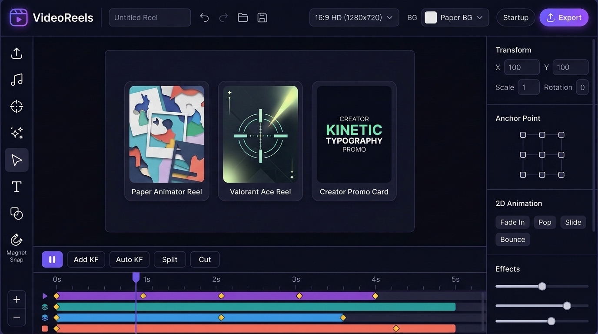
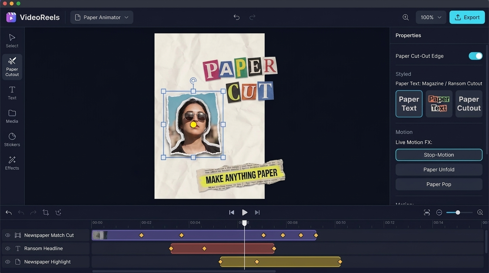
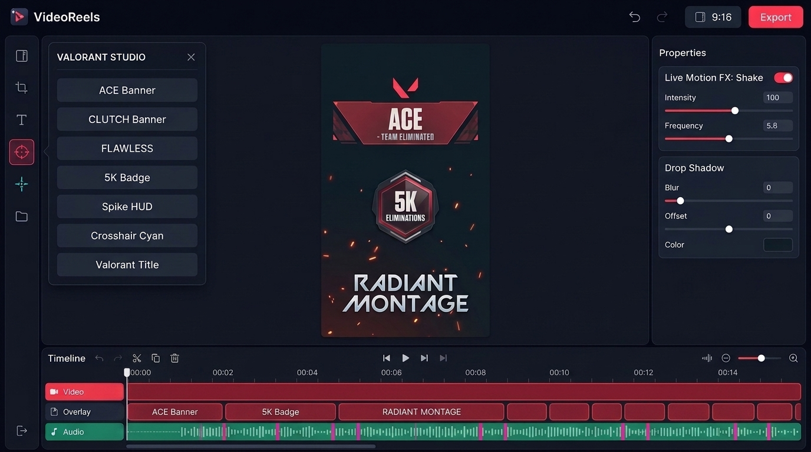

# VideoReels

A cross-platform **2D Motion, Paper Animator & Valorant Reel Studio** built with **Electron**, **React**, **TypeScript**, **Konva**, and **Tailwind CSS**.

Create vertical Shorts/Reels, tactile stop-motion paper cutout animations, or gaming montages with a full keyframe timeline, automatic audio beat detection, procedural particle FX, and multi-format export (**MP4**, **WebM**, **GIF**, **PNG**, **JPG**).

---

## Screenshots

### Editor Overview & Quick Templates


### Paper Animator Mode (Torn Cutouts, Ransom Text & Match Cut)


### Valorant Studio & Audio Beat Timeline


---

## Key Features

### 1. 2D Canvas & Layer Editing
- **Image & Video Upload**: Drag and drop or upload images (`.png`, `.jpg`, `.webp`, `.svg`, `.gif`) and video clips (`.mp4`, `.webm`, `.mov`).
- **8-Handle Cursor Resize & Rotation**: Resize width and height independently from any edge or corner handle, with `Shift` for aspect-ratio lock.
- **Custom Anchor Point (Pivot)**: Choose any point on the 3×3 anchor grid or fine-tune **Pivot X / Y (0%–100%)** with a live yellow crosshair target on the canvas.
- **Inline Text Editing**: Double-click any text layer on the canvas to edit directly, with custom font, size, color, alignment, and text outline.
- **Shapes & Effects**: Rectangles, ellipses, and arrows with corner radius, drop shadow, flip horizontal/vertical, blend modes (`Normal`, `Multiply`, `Screen`, `Overlay`, `Darken`, `Lighten`), and image filters (Brightness, Contrast, Saturation, Hue, Blur, Grayscale, Sepia).
- **Center Snap Guides & Quick Align**: Snap to canvas center while dragging, or align to any edge/center in one click.

### 2. Paper Animator Studio
- **Paper Cut-Out Edge**: Wrap any image in a realistic torn-paper border with customizable paper color, border size, and tear roughness.
- **Paper Text Styles**: Switch any text layer between **Normal**, **Magazine / Ransom Cutout** (mismatched paper letter tiles), and **Newspaper Highlight** (animated marker swipe).
- **Paper Text Match Cut**: Fast-cutting dictionary/newspaper pages behind a locked center highlight box.
- **Paper Stock & Green Screen Backdrops**: **Crumpled Paper**, **Kraft Cardboard**, **Newsprint**, **Grid Notebook**, **Green Screen (`#00FF00`)**, or **None** (transparent).

### 3. Valorant Studio Pack
- One-click tactical overlays from the **Valorant Studio** drawer (`Crosshair` icon in toolbar):
  - **ACE Banner**, **CLUTCH Banner**, **FLAWLESS Banner**
  - **5K Kill Badge**, **Spike Planted HUD**
  - **Crosshair (Cyan & Red)**, **Valorant Title**

### 4. Timeline, Keyframes & Audio Beat Detection
- **Keyframe Animation**: Add, drag, and re-time keyframes with `Linear`, `Ease In`, `Ease Out`, `Ease In-Out`, and `Bounce` easing, plus **Auto KF** mode.
- **Live Procedural Motion FX**: Apply instant **Stop-Motion**, **Paper Unfold**, **Paper Pop**, **Shake**, **Float**, **Pulse**, **Glitch**, or **Flash** with adjustable intensity and speed.
- **Particle FX Overlays**: **Ember Sparks**, **Anime Speed Lines**, **Party Confetti**, and **Atmospheric Dust**.
- **Audio Track & Beat Markers**: Upload `.mp3`, `.wav`, or `.ogg` audio to render a live waveform and auto-detect beat markers on the timeline.
- **Split & Cut**: Trim clip edges, split at the playhead (**Split**), or click anywhere on a clip in **Cut** mode while preserving layer order and video `trimStart`.

### 5. Multi-Format Export & Project Files
- **MP4 Video (`.mp4`)**: Hardware-accelerated H.264 encoding via WebCodecs + `mp4-muxer`.
- **WebM Video (`.webm`)**: VP9/VP8 video with alpha transparency support.
- **Animated GIF (`.gif`)**: Encoded via `gifenc` with transparent background support.
- **PNG / JPG Frame (`.png`, `.jpg`)**: High-resolution snapshot at the current playhead (with true alpha on PNG).
- **Save / Open Project (`.vreel`)**: Save and reload full project timelines and layers.
- **Startup Settings**: Animated splash screen with **Splash Screen** and **Background Startup** ON/OFF toggles in the top bar.

---

## Keyboard Shortcuts

| Shortcut | Action |
|---|---|
| `Space` | Play / Pause timeline |
| `ArrowLeft` / `ArrowRight` | Step backward / forward 1 frame |
| `Ctrl + Z` | Undo |
| `Ctrl + Y` / `Ctrl + Shift + Z` | Redo |
| `Delete` / `Backspace` | Delete selected layer |

---

## Getting Started

### Prerequisites
- **Node.js** 18+ (20 recommended)
- **npm** or **bun**

### Install & Run

```bash
# Install dependencies
npm install --legacy-peer-deps

# Start in development mode (Electron + Vite HMR)
npm run dev
```

### Build Desktop Installers

```bash
# Type-check, build, and package with electron-builder
npm run build
```

Built installers are output to `release/<version>/`:
- **Windows**: `Videoreels-Windows-<version>-Setup.exe` (NSIS)
- **macOS**: `Videoreels-Mac-<version>-Installer.dmg`
- **Linux**: `Videoreels-Linux-<version>.AppImage`

---

## CI/CD (GitHub Actions)

The included workflow at [`.github/workflows/build.yml`](.github/workflows/build.yml) automatically builds installers for **Windows**, **macOS**, and **Linux** on pushes/PRs to `main`/`master` and publishes GitHub Releases when pushing `v*` tags.

---

## Tech Stack
- **Desktop**: Electron 30 + `electron-builder`
- **UI**: React 18, TypeScript, Tailwind CSS v4, Lucide Icons
- **Canvas**: Konva & `react-konva`
- **State**: Zustand
- **Export**: WebCodecs + `mp4-muxer` (MP4), `MediaRecorder` (WebM), `gifenc` (GIF)
